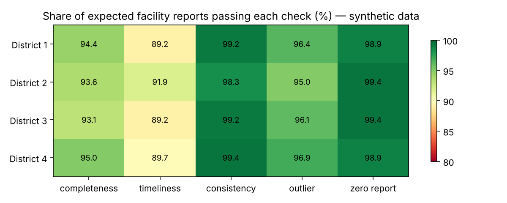

# health-data-quality-checks

Reusable data-quality checks for **routine health facility reports** (monthly aggregate data of the kind held in DHIS2, HMIS and national health data warehouses), written in Python and PostgreSQL.

The checks follow the four dimensions of the WHO *Data Quality Review* framework:

| Check | What it flags | Function | SQL |
|---|---|---|---|
| Completeness | expected facility-month with no report | `completeness()` | ✓ |
| Timeliness | report submitted after the deadline | `timeliness()` | ✓ |
| Internal consistency | impossible combinations, e.g. malaria positives > malaria tested | `consistency()` | ✓ |
| Outliers | values far from the facility's own median (modified z-score) | `outliers_mad()` | ✓ |
| Zero reporting | every indicator reported as 0 (placeholder submissions) | `zero_reporting()` | ✓ |

Flags are scored into a **per-facility and per-district quality score**: the share of expected reports that pass each check.

> This repository is the open, reusable companion to my work on data quality in Uganda's national health data systems — see *Strengthening Data Quality in National Health Data Warehouses* (ACM SEiGS '26, [doi:10.1145/3786176.3788341](https://doi.org/10.1145/3786176.3788341)).
>
> **All data here are synthetic.** No Ministry of Health or patient data are included.



## Quick start

```bash
pip install -r requirements.txt
python examples/run_demo.py     # generates data, runs checks, writes examples/output/
pytest -q                       # 6 tests
```

```python
from hdq import make_facility_reports, run_all, facility_scores, district_summary

df = make_facility_reports()          # synthetic data with known, injected problems
flags = run_all(df)                   # one row per flag: facility, period, check, detail
scores = facility_scores(df, flags)   # % of expected reports passing each check
print(district_summary(scores))
```

To use your own data, supply a DataFrame with `district, facility_id, period, submitted_at, deadline` and the indicator columns.

## Validation on synthetic data

The generator injects five kinds of known problems (missing, late, inconsistent, extra-digit typing errors, all-zero reports) and records them in a hidden `_injected` column, so each check can be tested against ground truth.

| Injected problem | Recall |
|---|---|
| Late submission | 1.00 |
| Inconsistent values | 1.00 |
| Extra-digit typing error | 1.00 |
| All-zero report | 1.00 |

The outlier check is deliberately sensitive: of 56 facility-months it flags, 29 are injected errors; the rest are genuinely unusual months in the simulated data. In practice, outlier flags are a prompt for **verification**, not automatic correction.

## PostgreSQL

`sql/dq_checks_postgres.sql` implements the same checks as one query returning `district, facility_id, period, check_name, detail`. It has been run against PostgreSQL 16 and returns the same counts as the Python version (outlier SQL covers `anc1_visits` as a worked example).

## Project layout

```
hdq/            checks, scoring and the synthetic data generator
sql/            PostgreSQL version of the checks
examples/       end-to-end demo script and output
tests/          pytest suite checking each rule against injected problems
```

## Roadmap

- Cross-source consistency (e.g. community vs facility reporting of the same indicator)
- Seasonal-aware outlier rules (see [routine-data-anomaly-detection](https://github.com/moseskizito/routine-data-anomaly-detection))
- dbt / SQL-view packaging for data-warehouse deployment

## License

MIT © Moses Kizito
